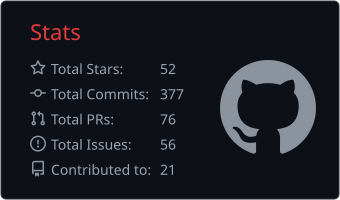
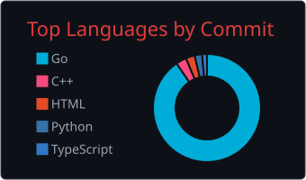
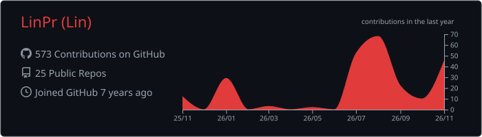

<h1>Lin · LinPr </h1>

  
  
  
  

<i>Quietly, but surely.</i>

---

##  About Me

<table>
<tr>
<td width="62%" valign="top">

I'm <b>Lin</b> — a Go developer who builds <b>terminal-native tools for the cloud</b>. My happy place is somewhere between a Bubble Tea TUI, an S3 bucket, and a Grafana dashboard.

I care about fast feedback loops, sharp interfaces, and software that stays out of your way. Most of my work lives at the intersection of <b>Go</b>, <b>Kubernetes</b>, <b>observability</b>, and <b>developer experience</b>.

<ul>
  <li>🔭 <b>Building</b> — TUI tools for SQL / NoSQL, S3 and OpenObserve</li>
  <li>☁️ <b>Exploring</b> — Kubernetes, GitOps and observability at scale</li>
  <li>🌱 <b>Learning</b> — advanced system design, Kubernetes internals and microservices</li>
  <li>💬 <b>Ask me about</b> — Go, CLI/TUI UX, and cloud-native tooling</li>
</ul>

</td>
<td width="38%" valign="top">

</td>
</tr>
</table>

##  Tech Stack

**Languages** 
    

**Cloud Native** 
     

**Observability & Data** 
        

**Daily Drivers** 
   

##  Featured Work

Terminal-first tools for databases, object storage, and observability.

| Project | What it does | Built with |
|:--|:--|:--|
| 🗄️ **[sqltui](https://github.com/LinPr/sqltui)**  | Browse, query and edit SQL / NoSQL databases without leaving the shell. | `Go` `Bubble Tea` |
| 📊 **[grafana-openobserve-datasource](https://github.com/LinPr/grafana-openobserve-datasource)**  | Query OpenObserve logs and traces directly from Grafana. | `Go` `Grafana` |
| 🪣 **[lazys3](https://github.com/LinPr/lazys3)**  | A lazy S3 browser for the terminal, built on Bubble Tea. | `Go` `AWS S3` |
| ☁️ **[s6cmd](https://github.com/LinPr/s6cmd)**  | An s3cmd / `aws s3` alternative in Go — fast and script-friendly. | `Go` `AWS SDK v2` |
| 👁️ **[o2tui](https://github.com/LinPr/o2tui)**  | OpenObserve in your terminal — because dashboards deserve a CLI too. | `Go` `TUI` |

…and more experiments on <a href="https://github.com/LinPr?tab=repositories">GitHub</a>.

##  GitHub Stats

 

 

Refreshed weekly by <a href="https://github.com/LinPr/LinPr/blob/main/.github/workflows/refresh-cards.yml">this workflow</a>.

---

### See you in the shadows.

Itachi Uchiha & Naruto © Masashi Kishimoto / Studio Pierrot · animated clips via <a href="https://tenor.com/search/itachi-gifs">Tenor</a>, used for personal fan purposes.

